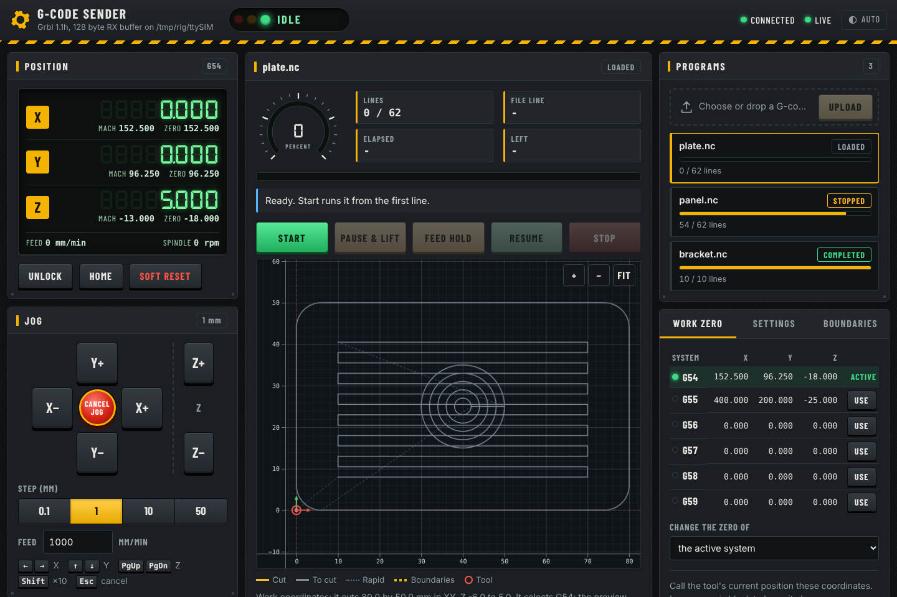
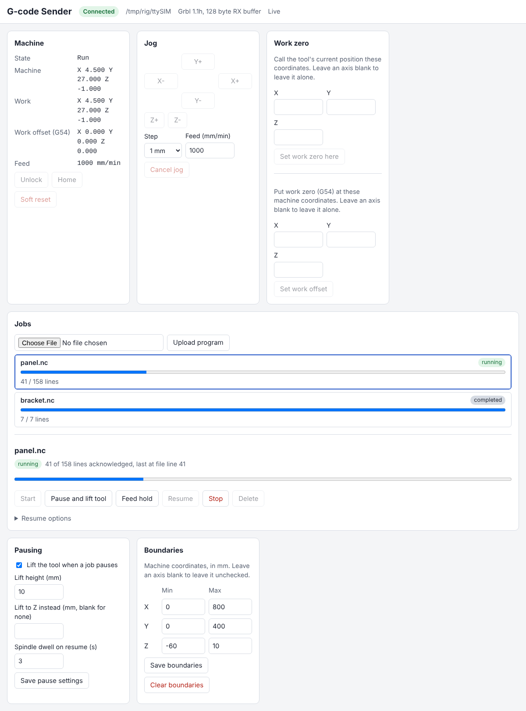
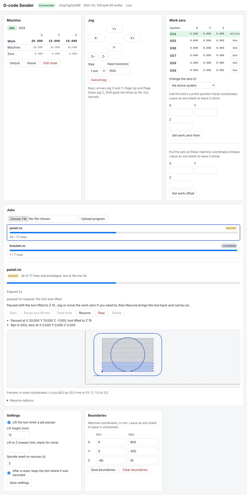
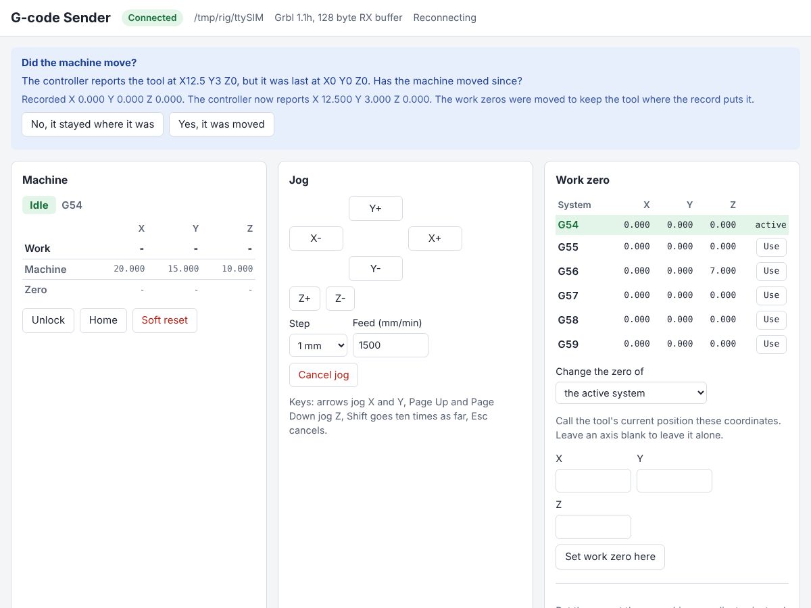
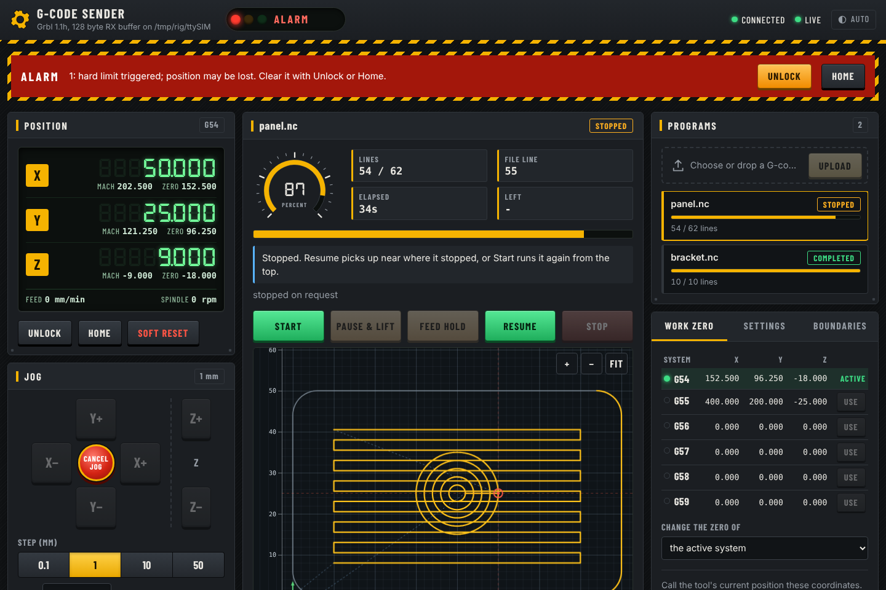
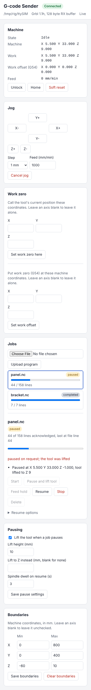

# gcode-sender

A G-code sender for GRBL-family CNC controllers, driven entirely over an
HTTP API. It is built for the Sienci LongMill MK2 first and takes
[gSender](https://github.com/Sienci-Labs/gsender) as its reference for how
to talk to the machine.

The sender owns the USB serial port and serves two things on the same
address: the HTTP API, and a single-page web UI at `/` that is built on top of
that API. Clients can use either. The UI can upload a program, start, pause,
resume and stop it, jog, set work zero and boundaries, and follow progress
live.

## Layout

This is a monorepo.

| Path | What it is |
| --- | --- |
| `crates/gcode-sender` | The sender: serial link, job streaming, HTTP API, and the web UI it serves |
| `crates/grbl-sim` | A simulated controller on a pseudo-terminal, used by the tests |
| `web/` | The web UI: `index.html`, `style.css`, `app.js` (the page, an Alpine component), `preview.js` (the toolpath viewport, with d3), `lib.js` (the pure logic, with tests in `lib.test.js`), and `vendor/` (Alpine, d3 and two fonts). Plain files, no build step |

The web UI is compiled into the sender binary (`crates/gcode-sender/src/web.rs`),
so the server is the only thing to copy onto the machine. Edit the files in
`web/` and rebuild. There are no build tools: the page uses
[Alpine.js](https://alpinejs.dev) (its CSP build, so the page's strict content
security policy stays) and [d3](https://d3js.org), both copied into
`web/vendor/` with the fonts, so the page loads nothing from the internet. See
`web/vendor/README.md` for where each file came from. It targets current
browsers. The logic that can be wrong without anyone noticing (the toolpath
parser, time estimates, key mapping) lives in `web/lib.js` and is checked with
`node --test web/lib.test.js`.

## Web UI

The UI is laid out like a machine's control panel: a stack light that says
what the controller is doing (green when fine, blinking while it moves, amber
when it waits on you, red for an alarm or no controller), a seven-segment
position readout, a jog pad with a cancel button in the middle, and the job's
toolpath on a dark viewport. It has a light and a dark theme (it follows the
system until you pick one with the button in the header), and on a phone a
dock at the bottom switches between Machine, Job and Setup.

The UI only offers what the machine can do right now. A button that cannot
work is disabled and says why when you hover it, and the selected job shows a
one-line hint about what to do next.

- **Position**: the work position large, with machine position and zero
  under each axis, feed and spindle, and the active work system. The tab title
  shows state and job progress, so you can watch from another window.
- **Jog**: buttons, or the keyboard: arrow keys for X and Y, Page Up and Page
  Down for Z, Shift for ten times the step, Esc to cancel. Keys are ignored
  while typing in a field. The step and feed are remembered.
- **Job**: start, pause with tool lift, feed hold, resume (with options),
  stop. A dial and a bar show progress, with elapsed and estimated remaining
  time and why a job paused or failed. The toolpath is drawn from the exact
  program that was uploaded (`GET /jobs/{id}/program`): what has been cut,
  what is left, rapids, the boundaries and the tool, with rulers in mm. Drag
  to pan, scroll or pinch to zoom, Fit to go back; the pointer's position is
  shown in the corner. It warns if the program would leave the boundaries
  from the current work zero.
- **Programs**: choose or drop a file to upload; the list shows each job's
  state and progress.
- **Setup**: **Work zero** lists G54 to G59 with their zeros, switches with
  one click, and the zero forms apply to the system you pick. **Settings** and
  **Boundaries**: saving a setting keeps the ones the form does not show.
- **Position check**: after a reset or a lost connection, the sender asks
  whether the machine was moved. The UI shows that question at the top of the
  page with both answers, and says when jobs are waiting for the answer.
- **Alarm**: a striped banner with Unlock and Home.








## Remote access

The machine itself uses plain HTTP on `--listen`, which defaults to
`127.0.0.1:8080`. That address must be a loopback address, so only this
machine can reach it. Its own pages need no code.

Other computers use HTTPS on `--remote`, which defaults to `0.0.0.0:8443`.
Pass `--no-remote` to turn that off. The sender makes a self-signed
certificate on first run and keeps it in `data/tls/`, so it stays the same
across restarts. Each browser warns that the certificate is not trusted, and
you accept it once. To pair:

1. On the machine, open the UI and go to **Setup → Remote access**. It shows a
   six-digit code, valid for five minutes.
2. On the other device, open `https://<machine>:8443/`, accept the certificate
   warning, and enter the code.
3. The browser keeps a session cookie and stays paired until you revoke it on
   the same tab. Five wrong guesses use up a code, and the machine then shows a
   new one.

Programs pair the same way: `POST /pairing` with `{"code": "123456"}` returns a
`token`, which they send as `Authorization: Bearer <token>`. Use `-k` with curl,
since the certificate is self-signed.

Protections against other sites, paired or not:

- A request made by a page of another site is refused with `403`. A browser
  marks such requests with `Sec-Fetch-Site`, and they carry an `Origin` that is
  not the sender's own address. A jog cannot be sent through the browser of a
  visitor who happens to be using the sender.
- The session cookie is `HttpOnly`, `SameSite=Strict` and `Secure`.
- Only the plain-HTTP listener on this machine is trusted without a token. A
  request that comes in over HTTPS always needs a paired browser, even from
  this machine.
- Tokens are kept as SHA-256 hashes in `data/devices.json`, so the file does
  not hold anything that works as a login. Paired browsers survive a restart.
- Pairing is managed only from the machine itself (`GET /pairing`,
  `POST /pairing/code` and `DELETE /pairing/devices/{id}`).

The certificate is self-signed, so the browser cannot confirm that it is talking
to this sender. Anyone who can intercept the first connection could impersonate
the sender. Use remote access on a network you trust, or reach the sender
through a VPN or an SSH tunnel.

## Supported controllers

The LongMill MK2 has shipped with two controller boards, and both work over
USB serial at 115200 baud:

| Board | Firmware | RX buffer |
| --- | --- | --- |
| LongBoard (Arduino based) | Grbl 1.1 | 128 bytes |
| SuperLongBoard (SLB) | grblHAL | 1024 bytes |

The server identifies the firmware with `$I` when it connects and reads the
RX buffer size from the `[OPT:...]` line, so no configuration is needed for
either board.

## Running

```sh
cargo run --release -p gcode-sender -- --port /dev/ttyACM0 --data-dir ./data
```

| Option | Default | Meaning |
| --- | --- | --- |
| `--port` | (required) | Serial port of the controller |
| `--baud` | `115200` | Baud rate |
| `--listen` | `127.0.0.1:8080` | HTTP address for this machine. It must be loopback; port `0` picks a free one. See [Remote access](#remote-access) |
| `--remote` | `0.0.0.0:8443` | HTTPS address for remote browsers, with a self-signed certificate. See [Remote access](#remote-access) |
| `--no-remote` | off | Serve only this machine, with no remote browsers |
| `--data-dir` | `./data` | Where jobs are stored |
| `--rx-reserve` | `8` | Bytes of the RX buffer left unused as a margin |
| `--poll-ms` | `200` | Status report interval |
| `--reconnect-ms` | `1000` | Delay between attempts to open the port |
| `--silence-timeout-ms` | `3000` | Treat the link as dead after this long without hearing from the controller |
| `--ack-timeout-ms` | `30000` | Treat an acknowledgement as lost after lines stay unacknowledged this long while the machine is idle. Keep it above your longest dwell (`G4`) |

Each option can also be set with an environment variable such as
`GCODE_SENDER_PORT`. Logging is controlled with `RUST_LOG`.

## HTTP API

All responses are JSON. Errors look like `{"error": "..."}` and use 404 for
an unknown job, 409 when the request does not fit the current state, 422
for an invalid program, and 503 when the machine is not connected or not
identified yet.

| Method and path | What it does |
| --- | --- |
| `GET /health` | Liveness check |
| `GET /events` | Live stream of machine and job changes, see below |
| `GET /machine` | Connection, firmware, live status, alarm, and the active job |
| `POST /jobs?name=<name>` | Upload a program; the body is the G-code text. Returns `201` |
| `GET /jobs` | List jobs, oldest first |
| `GET /jobs/{id}` | One job, with live progress while it runs |
| `GET /jobs/{id}/program` | The program as uploaded, as plain text, so its line numbers match `last_acked_line` and `line_errors` |
| `DELETE /jobs/{id}` | Delete a job that is not active |
| `POST /jobs/{id}/start` | Start streaming. Also re-runs a finished job from the top |
| `POST /jobs/{id}/pause` | Stop the machine, lift the tool and free the machine for jogging; see below. A body of `{"lift": false}` makes it a plain feed hold |
| `POST /jobs/{id}/resume` | Bring the tool back and continue, or, after a plain hold, cycle start. Also continues an `interrupted`, `stopped` or `failed` job, with options; see below |
| `POST /jobs/{id}/stop` | Feed hold, then soft reset once the machine is at rest |

| `POST /machine/unlock` | `$X`: clear an alarm lock |
| `POST /machine/home` | `$H`: run the homing cycle |
| `POST /machine/reset` | Soft reset, for example to clear a hold left by an earlier session |
| `POST /machine/work-zero` | Make the tool's current position a work coordinate, see below |
| `POST /machine/position-check` | Answer whether the machine moved, see below |
| `PUT /machine/work-offset` | Set where a work zero is in machine coordinates, see below |
| `PUT /machine/work-system` | Make a work coordinate system (G54 to G59) the active one, see below |
| `POST /machine/jog` | Move the tool by hand, see below |
| `POST /machine/jog/cancel` | Stop a jog in progress and drop the queued ones |
| `GET /settings` | The sender's settings, see below |
| `PUT /settings` | Replace the settings |
| `GET /machine/bounds` | The machine boundaries, see below |
| `PUT /machine/bounds` | Set the boundaries |
| `DELETE /machine/bounds` | Remove the boundaries |

The `/machine` actions are refused while a job is active; stop the job
first.

Only one job is active at a time. A job's `state` is one of `loaded`,
`running`, `paused`, `stopping`, `completed`, `stopped`, `failed`, or
`interrupted`. Records also carry `total_lines`, `acked_lines`,
`last_acked_line` (a line number in the uploaded file), `line_errors`, and
a `reason` for pauses and failures. A rejected line is recorded with its
error code and what the code means, and alarms are explained in `reason`
and in `GET /machine`.

```sh
id=$(curl -s --data-binary @part.nc 'localhost:8080/jobs?name=part.nc' | jq -r .id)
curl -s -X POST localhost:8080/jobs/$id/start
curl -s localhost:8080/jobs/$id | jq '{state, acked_lines, total_lines}'
```

## How it works

- **Streaming.** Comments, blank lines, and `%` are stripped, then lines
  are sent with GRBL character counting: a line goes out only when it fits
  in what is left of the controller's RX buffer.
- **Completion.** A job completes when every line is acknowledged and the
  machine reports `Idle`, not when the last `ok` arrives.
- **Errors and alarms.** A line answered with `error:N` holds the machine
  and pauses the job, recording the file line number, so an operator can
  decide whether to resume or stop. An alarm fails the job; clear it with
  `POST /machine/unlock` or `POST /machine/home`.
- **Stopping.** The server sends a feed hold, waits for `Hold:0` (or
  `Idle`), and only then sends a soft reset, so the machine decelerates
  and keeps its position instead of raising `ALARM:3`.
- **State on disk.** Jobs live under `--data-dir` as the uploaded program
  plus a JSON record written with an atomic rename. Progress is saved
  every 250 ms while running. Each rename is synced to disk, so a power cut
  leaves the old or the new record, never a mix. A job appears only once its
  program and record are both written, and a record that cannot be read is
  skipped with a warning rather than stopping the server. The tool's last
  known position is kept in `position.json` the same way, see below.

### Pausing and resuming

By default a pause moves the tool out of the way, so the machine is free
to be moved by hand and the job can be resumed from the same place.

1. The server sends a feed hold and waits for the machine to stop.
2. It records the tool's position and soft-resets the controller, which
   throws away what was queued and stops the spindle.
3. It lifts the tool by `pause.height` (10 mm by default) with a jog, never
   past the Z boundary, or to `pause.z` if that is set. A jog is used because
   the controller refuses one that would leave its travel, where a plain move
   raises an alarm.
4. The job is released: it stays `paused`, with `paused_at` giving the
   position (`position`) and the Z it was lifted to (`lifted_to`), and the
   machine is free again. Jog, change the work zero, or just wait.

`POST /jobs/{id}/resume` then brings the tool back whatever happened in
between: it rises to a safe Z (the height it was lifted to, or higher), travels
over the point where the program picks up, restarts the spindle and coolant
if the program had them on, waits `pause.dwell_s` seconds for the spindle to
reach speed, plunges at the program's feed rate, and carries on. The
program is picked up a few lines before where it stopped (up to the
controller's planner depth plus one, the same as resuming after a dropped
connection), so those lines are cut again over the same path. A pause that
is still lifting answers `409` to a resume; try again in a moment.

Things to know:

- **The spindle stops** at the reset, before the lift. Pass
  `{"lift": false}` for a pause that keeps it running.
- If the controller refuses the lift (it is at the top of its travel, say) or
  the tool is already as high as the Z boundary allows, the job is still
  paused and released, with `lifted_to` null and the reason saying why. If
  the program cannot be picked up again (it uses `G92`, `G10`, `G28`, `G30`,
  `G59.1` to `G59.3`, or is in `G91` there), the pause is a plain feed
  hold, and the reason says so.
- `POST /jobs/{id}/stop` on a released pause just retires the job. A
  released pause survives a server restart; moving the work zero in
  between is caught, as for any resume (`accept_moved_zero`).
- If the server stops while the tool is being lifted, the job comes back
  paused at the height it was lifting to, and resume raises the tool there.
  The lift may or may not have finished, and the reason says so. While the
  lift is under way the record carries that height as `lift_pending`.
- Giving `retract` to `resume` overrides the automatic return.
- A line the controller rejects still holds the machine in place, without
  lifting, since something is wrong and the operator should look first.

The behaviour is a setting, on by default:

```sh
curl localhost:8080/settings
# {"pause":{"lift":true,"height":10.0,"z":null,"dwell_s":3.0},"position":{"trust_record":true}}

# A pause is a plain feed hold; resume is a cycle start.
curl -X PUT localhost:8080/settings -H 'content-type: application/json' \
  -d '{"pause": {"lift": false}}'

# Or per pause:
curl -X POST localhost:8080/jobs/$id/pause -H 'content-type: application/json' \
  -d '{"height": 25}'
```

`PUT /settings` replaces the whole document, so leave out what should stay at
its default. They are kept in `settings.json` in the data directory.
`dwell_s` has to stay below `--ack-timeout-ms`.

### Interrupted jobs and resuming

A job becomes `interrupted` when the serial connection drops, the
controller stops answering, the controller resets, or the server stops
while the job is active. The server keeps reconnecting by itself.

`POST /jobs/{id}/resume` continues an `interrupted`, `stopped` or `failed`
job once the machine is connected, `Idle`, and not in alarm (clear one with
`POST /machine/unlock`). With no body it does three things:

1. **Backs up.** The saved progress can lag the controller, and a reset or
   stop throws away whatever was still in its planner, so the job restarts
   a little before the last acknowledged line: the controller's planner
   depth plus one line. The job record's `resumed_from_line` says where.
2. **Restores modal state.** Before the program continues, the server sends
   the units, distance mode, plane, work offset, feed mode, coolant,
   spindle, and feed rate the program had at that point.
3. **Moves straight to the next line.** There is no retract by default, so
   check where the tool is before you resume.

Two options, sent as a JSON body, make it safer:

```sh
# Lift, travel above the work, bring the spindle back, and plunge.
curl -X POST localhost:8080/jobs/$id/resume -H 'content-type: application/json' \
  -d '{"retract": {"z": -5, "dwell_s": 3}}'

# Start from a file line you choose, with no backing up.
curl -X POST localhost:8080/jobs/$id/resume -H 'content-type: application/json' \
  -d '{"from_line": 120}'
```

- `retract.z` is the safe height in machine coordinates, in millimetres.
  The server sends, in order: a lift to that Z, a rapid to the XY of the
  resume point, the coolant and spindle the program had, an optional
  `dwell_s` wait for the spindle (keep it below `--ack-timeout-ms`), a
  plunge back to the resume point's Z at `plunge_feed` (millimetres per
  minute; by default the program's own feed rate), and then the rest of the
  modal state. These moves are in machine coordinates and millimetres, so a
  program in inches or with another work offset cannot misplace them.
- A retract has to go up. It is refused with `422` if `z` is below the
  tool's current Z or below the resume point's Z, which catches a sign
  mistake, and if it is outside a Z boundary.
- `from_line` is a file line number. A comment or blank line means the next
  line of code, and `0` means the top of the program.
- Neither option applies to a job paused by a plain feed hold; plain `resume` continues those.

Repeating absolute moves is harmless; repeating incremental ones is not.
A program in `G91` at the resume point is refused with `422`, as is one
that uses `G92`, `G10`, `G28`, `G30`, or `G59.1` to `G59.3` before that
point, because the server cannot rebuild that state. Those
jobs can still be started again from the top.

If the controller resets while moving (an Arduino based LongBoard does when
the USB port reopens), it raises `ALARM:3` and may have lost its position.
The server will not resume until you have dealt with the alarm.

### Where the tool is

The sender is the only thing that moves the machine, so the sender keeps
the tool's last known position in `position.json` while it is connected,
along with every work zero (G54 to G59). Writes are throttled while the machine
moves and made as soon as it stops, so a stopped tool's position is exact.

After a restart or a reconnection the sender compares the position the
controller reports with the one it recorded, once the machine is idle. If
they agree, nothing happens. If they differ, the controller has most likely
lost its position (an Arduino based board that resets when the port opens
can report zero), while the tool stayed where it was. By default
(`position.trust_record`) the sender then:

1. moves every work zero (G54 to G59) by the same amount, so that the
   tool still reads where it was recorded in whichever system is active,
   and moves the stored zeros and paused positions of every job to match;
2. asks the operator whether the machine moved, through `GET /machine`.

```sh
curl localhost:8080/machine | jq .position_check
# {"recorded": [0, 0, 0], "reported": [3, 4, 1], "adjusted": true,
#  "question": "...Has the machine moved since?...", ...}

# The machine was not moved by hand: keep the correction.
curl -X POST localhost:8080/machine/position-check -H 'content-type: application/json' \
  -d '{"moved": false}'

# It was moved: put the zeros back and take the controller's report as it is.
curl -X POST localhost:8080/machine/position-check -H 'content-type: application/json' \
  -d '{"moved": true}'
```

The answer is refused with `409` while a job is active, and when no check is
waiting. Until it is answered, `position_check` stays in `GET /machine`.

To make the sender wait instead, turn trust off. A difference then blocks
starting and resuming jobs, with the question as the reason, until someone
answers. Nothing is moved in the meantime.

```sh
curl -X PUT localhost:8080/settings -H 'content-type: application/json' \
  -d '{"position": {"trust_record": false}}'
```

This relies on the controller stopping when the sender goes away. If a
controller keeps executing lines it had already buffered after the sender
has gone, the tool moves without the sender, and the check shows the
difference. Trust is then wrong until the operator answers.

### Watching the connection

- A status query goes out every `--poll-ms`. The controller answers even
  in the middle of a move, so total silence for `--silence-timeout-ms`
  means the link is dead. The server drops the connection and reconnects.
- If lines stay unacknowledged for `--ack-timeout-ms` while the machine is
  `Idle`, an acknowledgement was lost and nobody knows what the controller
  has received. The job fails and the controller is reset so nothing
  unknown is left in it.
- Line noise and unrecognised output are ignored. Acknowledgements left
  over from an earlier session are discarded while the controller is
  identified, so they cannot be mistaken for the new session's replies.

### Live events

`GET /events` is a server-sent event stream, so a client can follow a job
without polling.

```sh
curl -N localhost:8080/events
```

- `event: machine` carries the same JSON as `GET /machine`: connection,
  controller state, positions, alarm, and the active job.
- `event: job` carries a job record, as in `GET /jobs/{id}`. It is sent when
  the active job changes (progress, pause, resume) and once more with the
  final record when the job ends, whether it completed, stopped, failed or
  was interrupted. The job event comes before the machine event it explains.

The stream opens with the current state, so a client that reconnects has
nothing to catch up on. Events are sent only when something changed, and
changes within 100 ms are folded into one carrying the latest state, so a
slow client sees the current picture rather than a backlog; it is not a log
of every transition. Idle machines are quiet apart from keep-alive
comments. Ctrl-C ends open streams so the server can exit.

### Jogging

`POST /machine/jog` sends a Grbl `$J=` jog, which the controller runs
as a short move that can be cancelled at any moment. Distances and feed are
in millimetres and millimetres per minute.

```sh
# Move 10 mm along X and 2.5 mm back along Y from where the tool is.
curl -X POST localhost:8080/machine/jog -H 'content-type: application/json' \
  -d '{"x": 10, "y": -2.5, "feed": 1500}'

# Go to X0 Y0 in work coordinates, or add "space": "machine" for machine
# coordinates.
curl -X POST localhost:8080/machine/jog -H 'content-type: application/json' \
  -d '{"x": 0, "y": 0, "feed": 3000, "mode": "absolute"}'

curl -X POST localhost:8080/machine/jog/cancel
```

`mode` is `relative` (the default) or `absolute`; `space` (`work`, the
default, or `machine`) only applies to absolute jogs. The reply is `202`
once the controller has accepted the move, not when it finishes: watch
`GET /machine`, where the state is `Jog` while it runs. A jog the
controller refuses comes back with its error, for example `422` for
error:15 (the move leaves the machine's travel). Jogs sent while one is
running queue behind it, and cancelling drops them all. The cancel is a
realtime byte, so the machine does not reset and keeps its position.

Jogging is refused (`409`) during a job, an alarm, a hold or any other
state that is not idle, and (`503`) while disconnected. When boundaries are
set, the destination is checked first, counting the jogs still queued, and a
jog that leaves them is refused with `422`. As with jobs, this is on top of
the controller's soft limits, not instead of them.

### Work zero and work offsets

The controller keeps six work coordinate systems, G54 to G59, and each one's
zero survives power cycles. One of them is active: jogs in work coordinates
and `work_position` use it. `GET /machine` reports them under `work`, with
the active `system` and the `offsets` of all six in machine coordinates. The
active zero is also `status.work_offset`, next to `machine_position` and
`work_position`.

```sh
# The tool is at the corner of the stock: call this X0 Y0 in the active system.
curl -X POST localhost:8080/machine/work-zero -H 'content-type: application/json' \
  -d '{"x": 0, "y": 0}'

# The tool is touching the top of a 10 mm board: call this Z10 in G55.
curl -X POST localhost:8080/machine/work-zero -H 'content-type: application/json' \
  -d '{"z": 10, "system": "G55"}'

# Put the G56 zero at a known place on the machine.
curl -X PUT localhost:8080/machine/work-offset -H 'content-type: application/json' \
  -d '{"x": -100, "y": -50, "system": "G56"}'

# Make G55 the active system, for jogging and the work position.
curl -X PUT localhost:8080/machine/work-system -H 'content-type: application/json' \
  -d '{"system": "G55"}'
```

`system` is `G54` to `G59`. The zero and offset calls default to the active
system, and `work-system` needs one. `work-zero` sends `G10 L20 P<n>` and
`work-offset` sends `G10 L2 P<n>`, where `P` is 1 for G54 to 6 for G59, so a
zero can be set without selecting its system first. `work-system` sends
`G21 G90 G55` (or whichever system). Each takes `x`, `y` and `z` in
millimetres, and leaves the other axes alone, except that `work-system` takes
none. The commands send `G21 G90` first, so the controller is left in
millimetres and absolute mode whatever it was in before. A change is refused
(`409`) during a job, an alarm, or any state but idle, because the new zero is
measured from where the tool is at that moment.

The server reads the zeros back (`$#`) and the active system (`$G`) when the
controller connects, after each change, and every couple of seconds while
idle, so a zero changed from a panel shows up without a restart. Until the
first read the controller is not ready, and jobs wait for it.

A program starts in the active system and cuts in each system it selects with
`G54` to `G59`. Boundaries are in machine coordinates, so they stay put when a
zero moves. A program is checked against them using the zero of each system it
cuts in. Grbl 1.1 refuses `G59.1` to `G59.3`, so those are refused here too.

A job records the zeros it ran with (`work_offsets` on the job). Resuming a
stopped, failed or interrupted job after a zero that the rest of the program
cuts in has moved is refused with `409`, since the program would be cut
somewhere else. Put the zero back, or pass `"accept_moved_zero": true` to
resume anyway. A zero the program never uses can move freely.

### Boundaries

`PUT /machine/bounds` takes ranges in machine coordinates, in millimetres.
Leave an axis out to leave it unchecked.

```sh
curl -X PUT localhost:8080/machine/bounds -H 'content-type: application/json' \
  -d '{"x": [0, 800], "y": [0, 400], "z": [-60, 0]}'
```

When boundaries are set, a job is checked before any of it is sent, on
start and on resume. The whole program is followed from the machine's
current position, using the work offset the controller reports. Units,
absolute and incremental moves, `G53`, and arcs (including their bulge
between the end points, in the center and radius forms) are understood. A
move outside the boundaries is refused with `422` naming the line, the
axis and the value, and nothing reaches the controller. A program the
server cannot follow (`G92`, `G10`, `G28`, `G30`, `G59.1` to `G59.3`,
parameters, expressions) is refused too, because it could move anywhere.
These checks apply only while boundaries are set.

This complements the controller's own soft limits rather than replacing
them: it catches a bad program before it starts, but it knows nothing
about a tool length offset or a probe cycle that moves further than
planned.

## Testing

The test suite is acceptance tests only. Each test starts a simulated
controller (`crates/grbl-sim`) on a pseudo-terminal and a real
`gcode-sender` process pointed at it, then drives the server over HTTP and
checks what the controller received. The simulator models the RX buffer,
planner queue, realtime commands, feed hold deceleration, soft reset,
alarms, and the work offset. It can also unplug and replug the cable (with
or without the reset an Arduino board performs), go silent, lose
acknowledgements, inject line noise and `error:N` replies, and it flags any
RX buffer overflow.

```sh
cargo test
GCODE_SENDER_TEST_LOG=1 cargo test -- --nocapture   # with server logs
```

The tests need Linux or macOS for pseudo-terminals.

## Not done yet

- Probing and overrides.
- Reading and changing the controller's `$` settings.
- Resuming incremental programs.
- A job that starts and finishes between two events may never get its final
  `job` event on `GET /events`, since the stream only reports what it sees
  between samples. The web UI re-reads `GET /jobs` after its own actions and
  when the active job ends, so it is not affected, but other stream clients
  should re-read `GET /jobs/{id}` when they start or resume a job.
- Testing against a real LongMill. The simulator follows the Grbl 1.1
  documentation and gSender's behaviour, but real hardware has quirks.
